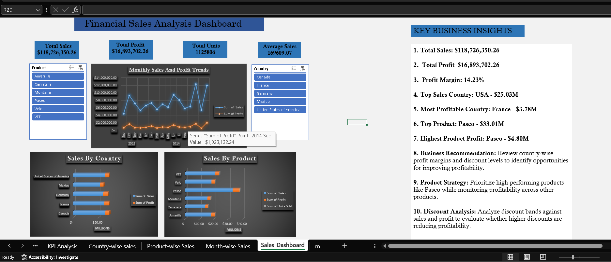

# Financial Sales Analysis Dashboard

## Project Overview
An interactive financial sales analysis project built using Microsoft Excel to analyze sales performance, profitability, product contribution, and monthly trends across multiple countries.

## Tools & Skills
- Microsoft Excel
- PivotTables and PivotCharts
- Slicers and interactive filtering
- KPI analysis and business reporting
- Data visualization and business insights

## Key Performance Indicators
- **Total Sales:** $118.73M
- **Total Profit:** $16.89M
- **Profit Margin:** 14.23%
- **Total Units Sold:** 1,125,806

## Key Business Insights
- **Highest Sales Country:** USA — $25.03M
- **Most Profitable Country:** France — $3.78M
- **Top Product by Sales:** Paseo — $33.01M
- **Highest Product Profit:** Paseo — $4.80M

## Dashboard Preview

## Dashboard Features
- Monthly sales and profit trends
- Country-wise sales and profit comparison
- Product-wise performance analysis
- Interactive country and product slicers
- KPI summary and business recommendations

## Business Recommendations
- Compare country-level profitability to identify improvement opportunities.
- Monitor product-level sales and profit to support product strategy.
- Analyze discount bands against profit to evaluate discount effectiveness.

## Project Files
- `Sales_Analytic_Dashboard.xlsx` — Excel dashboard and analysis
- `Dashboard_ss.png` — Dashboard screenshot

## Data Source
Microsoft Financial Sample dataset.

## Disclaimer
This is a portfolio learning project. Findings and recommendations are based on the dataset provided and should be validated before making real business decisions.
